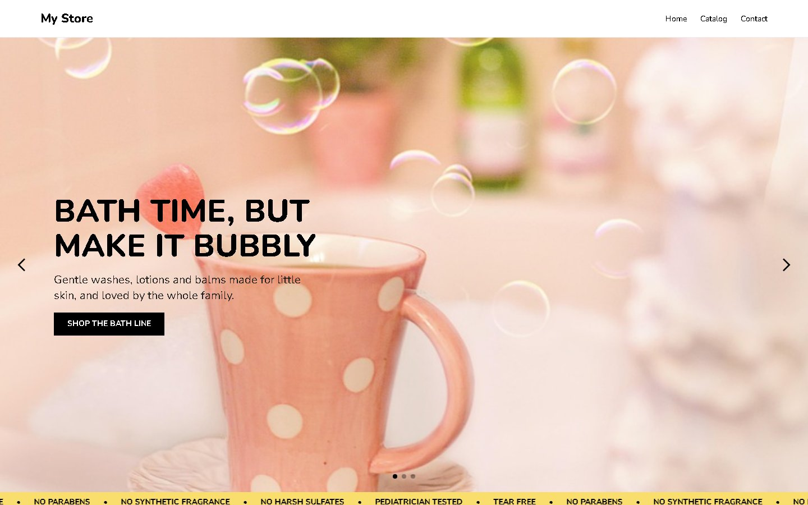
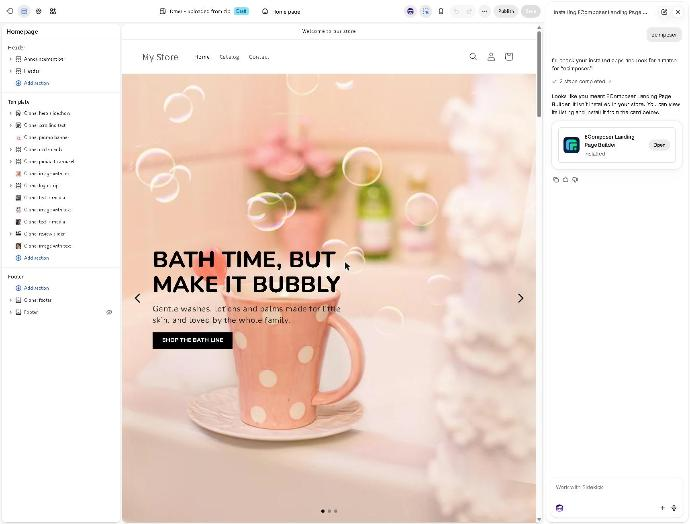
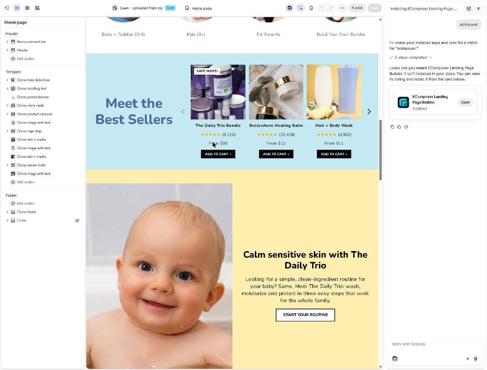
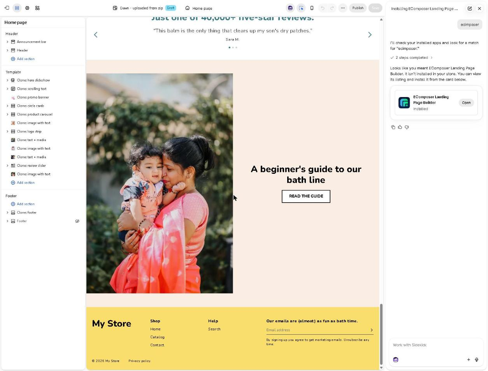

# baby-bath-store

صفحة رئيسية لمتجر منتجات استحمام وعناية للأطفال. الترتيب والألوان مأخوذين من دراسة tubbytodd.com، والنصوص مكتوبة من جديد، والصور من Pixabay (مجانية).

**نسخة HTML:** [html/index.html](html/index.html). نفس القالب بالضبط، تفتح في أي متصفح بدون Shopify (الأفضل من خلال `templates` في launch.json، أو افتح `../index.html` لمعرض كل القوالب).






## الأقسام (بالترتيب)

1. `ck-hero-carousel`: سلايدات بعرض الشاشة، عنوان كبير، زر أسود، أسهم ونقاط، وتتقلب لحالها.
2. `ck-marquee`: شريط أصفر متحرك.
3. `ck-promo-banner`: بانر عرض بصورة خلفية، والنص على اليمين.
4. `ck-circle-cards`: 4 صور دائرية مع روابط.
5. `ck-product-carousel`: الأكثر مبيعاً. يعرض الكولكشن اللي تختاره، وإذا ما اخترت كولكشن يعرض الكروت التجريبية.
6. `ck-image-text`: صورة + نص (يتكرر 3 مرات بألوان مختلفة).
7. `ck-logo-strip`: شريط لوقوهات.
8. `ck-rich-media`: عنوان + فيديو أو صورة + رابط أو زر (يتكرر مرتين).
9. `ck-testimonials`: سلايدر آراء العملاء.
10. `ck-footer`: فوتر أصفر فيه روابط واشتراك بالإيميل.

كل قسم فيه 50 إلى 75 إعداد في محرر الثيم: ألوان، خطوط، أحجام، مسافات، أعمدة كمبيوتر/تابلت/جوال، حركة، إظهار وإخفاء.

## التركيب

```bash
python ../install.py baby-bath-store "path/to/theme" --store xxx.myshopify.com --theme-id 123456
```

بعدها ارفع الصور من `images/` على **Content > Files** (نفس الأسماء).

## الملفات

- `sections/`: الأقسام العشرة (Liquid).
- `templates/index.json`: الصفحة الرئيسية بالترتيب والنصوص والصور.
- `templates/footer-section.json`: الفوتر.
- `images/`: الصور الـ 19، و`photo-credits.json` فيه رابط كل صورة على Pixabay.
- `source/gen.py`: السكربت اللي يولّد ملفات الأقسام. عدّل فيه وشغّل `python source/gen.py sections` عشان تعيد توليد الأقسام.
- `source/clone-manifest.json`: تقسيم الصفحة الأصلية وألوانها.
