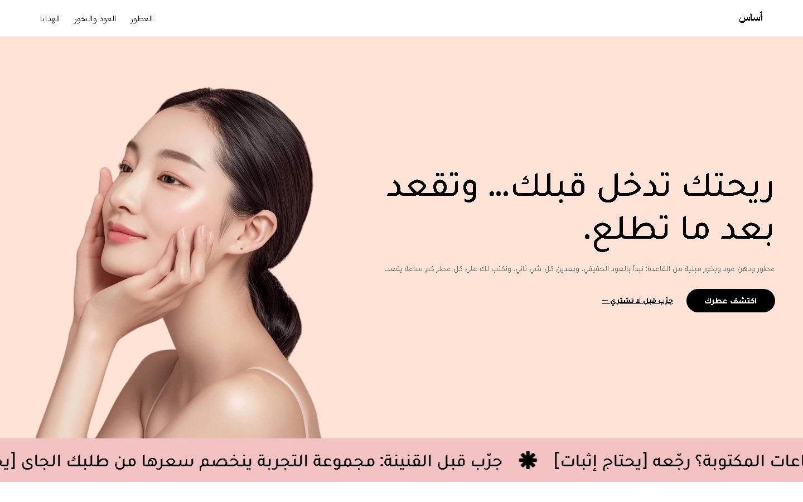

# perfume-oud-store

صفحة رئيسية لمتجر عطور وعود وبخور بالعربي (من اليمين لليسار). التصميم والترتيب مأخوذين من https://ecomposer.app/demo/6481، والصور هي صور المرجع نفسها (للتبديل بعدين)، والنصوص كوبي «أساس» من `مشروع-العطور/2-الكاتب/06-website-copy.md`.

**نسخة HTML:** [html/index.html](html/index.html). نفس القالب، تفتح بدون Shopify.



## الأقسام (بترتيب الصفحة)

أول 8 أقسام بنفس ترتيب المرجع وشكله:

1. `ck-ec-hero`: نص + صورة كبيرة.
2. `ck-ec-marquee`: شريط وردي متحرك مع نجمة.
3. `ck-ec-categories`: صور بيضاوية. بالكمبيوتر صف واحد يتحرك لجنب، بالجوال شبكة عمودين.
4. `ck-ec-products`: «الأكثر طلب». يعرض كولكشن إذا اخترته، وإلا الكروت التجريبية.
5. `ck-ec-split`: بانل بيج + صورة (العود الصدق).
6. `ck-ec-featured`: صورة جانبية + بانل منتج (طقم ريحة البيت).
7. `ck-ec-products`: الهدايا.
8. `ck-ec-cards`: 3 صور دائرية (مبني من القاعدة).

بعدها أقسام الكوبي اللي مو موجودة بالمرجع، بنفس الستايل: `ck-ec-quotes` (سمعناها منكم)، `ck-ec-split` (ليش يطير مع الجدول، إحنا نبدأ من تحت، جرّبها بنفسك، ريحة البيت، الدعوة الأخيرة)، `ck-ec-cards` (الطريقة القديمة، الإثبات، العرض والضمان)، `ck-ec-faq`. وآخر شي `ck-ec-gallery` (إنستقرام) و`ck-ec-newsletter` مثل آخر المرجع.

كل قسم فيه 60 إلى 95 إعداد بمحرر الثيم.

## مهم قبل التركيب

- **الصور بالـ assets:** كل صورة لها خانة «fallback theme asset»، يعني الصور تنقرا من `assets/` بالثيم (أسماء `ec-*.png/jpg`). انسخ `images/ec-*` و`images/ck-tajawal-*.woff2` لـ `assets/` بالثيم. إذا اخترت صورة من محرر الثيم، هي اللي تطلع بدل الـ asset.
- **العربي:** انسخ `source/theme-files/snippets/ck-arabic-font.liquid` لـ `snippets/`، وبـ `layout/theme.liquid` حط `` بعد `{{ content_for_header }}`، وخلي وسم `<html>` فيه `dir="rtl"` لما يكون `settings.ck_rtl` شغال. وزيد مجموعة «Arabic / RTL» في `config/settings_schema.json` (`ck_rtl`, `ck_lang`, `ck_arabic_font_enable`, `ck_arabic_font`, `ck_proof_label`). الثيم الكامل الجاهز موجود في `مشروع-العطور/3-شوبيفاي/theme`.
- **خانات «[يحتاج إثبات من البراند]»:** هذي أماكن لمعلومة لازم تجي من البراند (ساعات الثبات، تقييمات حقيقية، شروط الضمان...). لا تعبّيها بأرقام أو تقييمات من عندك.

## التركيب

```bash
python ../install.py perfume-oud-store "path/to/theme" --store xxx.myshopify.com --theme-id 123456
```

## الملفات

- `sections/`: 11 ملف قسم (Liquid).
- `templates/index.json`: الصفحة بالترتيب والنصوص.
- `images/`: صور المرجع (28) وخط Tajawal.
- `theme-settings.json`: قيمة `ck_proof_label` لنسخة الـ HTML.
- `source/gen.py`: يولّد ملفات الأقسام: `python source/gen.py <theme>/sections`.
- `source/build_index.py`: يكتب `templates/index.json` من الكوبي: `python source/build_index.py <theme>`.
- `source/head.html`: الخط العربي لنسخة الـ HTML.
